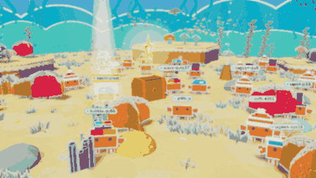

# 🦀 Stargazer Sea

<p align="center"><a href="README.md">🇩🇪 Deutsch</a> · <b>🇬🇧 English</b></p>

<p align="center">
  
</p>

<p align="center">
  <b>An animated paper sea of all stargazers: every star becomes a crab.</b><br>
  
</p>

<h3 align="center">👉 <a href="https://sea.eppacher.net/?lang=en">To the sea</a> 👈</h3>

## How to become a crab

1. **Give a star:** click ⭐ *Star* at the top right on GitHub.
2. **Enter your name:** on the site, click “Every star becomes a crab” and type your GitHub name. An egg with your name appears next to the treasure chest.
3. **Watch it hatch:** after 1–3 minutes the egg cracks open and your baby crab hatches. You see its rarity right away.
4. **Let it grow:** it is fully grown after 3 days. After 2 days the eggshell falls off and its hat is revealed.

## Growing up

| Age | Stage | Size | What you see |
|---|---|---|---|
| from the star | 🐣 Baby | 45 % | rarity, color, pattern, eggshell on its head |
| from 1 day | Youngling | 62 % | same as baby |
| from 2 days | Teen | 80 % | **hat is unwrapped**, variant and number visible |
| from 3 days | Grown-up | 100 % | everything |

The clock starts with your first star and is the same for every visitor. In the collector’s album, growing crabs lie wrapped up with a lock in the **nursery**, so nobody can peek early. A number on the 📖 shows how many crabs are new, have grown or were unwrapped since you last opened the album.

## Rarities

| Rarity | Chance | Hats |
|---|---|---|
| Common | 50 % | No hat, bobble hat, baseball cap |
| Uncommon | 25 % | Sailor hat, propeller hat, sea flower |
| Rare | 15 % | Top hat, pirate hat, Viking helmet |
| Epic | 7 % | Wizard hat, shark fin |
| Legendary | 2.5 % | Golden crown, halo (with wings) |
| Mythic | 0.5 % | Star crown |

**Every crab exists only once.** A variant is a fixed combination of hat, hat color, shell color and pattern, 4,140 in total. Every number is given out only once. When all combinations of a rarity are taken, a **2nd edition** starts (recognizable by colored claw tips), so the chances always stay the same.

**The first 100 crabs** wear a 🚩 founder flag forever.

## What’s in the sea

- Crabs walk, dance, sleep, greet each other, fall in love and make room when you click one
- 🥚 Star flow: the egg cracks, a baby crab hatches, 🐣 it grows and its hat is revealed after 2 days, 💗 “That’s me”: on your next visit the site greets you at your crab
- 📤 A trading card for every crab to share, 📖 a collector’s album with all variants
- 🌙 Day and night based on your local time, 🎄 winter and 🎃 Halloween decorations, 🎈 crab day on the anniversary of your star
- ⭐ Crab of the day, a treasure chest with confetti, quiet underwater sounds (off by default)
- 🌊 A dive while loading (tap to skip); the operating system’s “reduce motion” setting is respected
- 🌍 German and English: switch at the top left (otherwise it follows your browser language)

## Questions and answers

**How long until my crab shows up?**
Usually 1–3 minutes: that is how long the GitHub Action and Cloudflare need to publish the site again.

**Can I reroll?**
No. Rarity, hat and variant are rolled once with your first star and belong to your GitHub account forever.

**Can you see the hat in advance?**
No. It is rolled right away, but for the first 2 days the hat is stored only **encrypted** in `crabs.json` (it is not in the Git history or in the Action logs either). Only rarity, shell color and pattern are readable. After 2 days the Action unwraps it (it runs every hour, so at most about an hour later).

**What happens if I remove my star?**
Your crab is hidden (within 6 hours at most). If you star the project again, **exactly the same** crab comes back.

**Which data is shown?**
Only your public GitHub name, your public account ID and the time of your star. If you remove your star, your name is deleted from the file. The site sets no cookies and does not count visitors. Settings like “That’s me”, the sound or the language stay in your own browser only.

**Do I have to give a star to take part?**
No, the sea is open to everyone. It is a picture of everyone who starred the project.

## Technology

```
⭐ Star ─► GitHub Action ─► scripts/sync_stargazers.py ─► crabs.json (commit) ─► Cloudflare Pages
```

- A purely static site, **no build step**: HTML, CSS, JavaScript modules and [three.js](https://threejs.org) 0.160.0 (in `vendor/three/`).
- The Action runs on every star, every hour and on every push. Young crabs are sealed: for the first 48 hours, hat and variant number are stored only encrypted in `crabs.json` (HMAC-SHA256, key stored as a GitHub secret). Safety net: on API errors, a sudden drop in stars or a failed self-check, nothing is saved.
- Look from the number: Python (`scripts/sync_stargazers.py`) and JavaScript (`js/variants.js`) calculate the same way. `tests/variants_vectors.json` checks this.
- The code, comments and the sync script are in German; the site itself speaks German and English (`js/i18n.js`).

### View locally

```bash
python3 -m http.server 8000
# → http://localhost:8000
```

Without stars, a demo mode with example crabs runs. With fewer than 30 real crabs, grey “Example” crabs fill up the sea.

To try things out, add to the address: `?lang=en` or `?lang=de` (language), `?vorspulen=50` (50 hours into the future, for growing), `?zeit=23` (night), `?saison=winter|halloween|keine`, `?datum=2026-12-24`, `?reduced` (like “reduce motion”), `?hq` (no automatic quality reduction).

### Tests

```bash
pip install -r requirements-dev.txt
python -m playwright install chromium
python -m unittest discover -s tests -v
```

They also run automatically on every push (`.github/workflows/tests.yml`).

### Setup (your own sea)

The repo lives on GitHub, the site runs on Cloudflare Pages.

**GitHub**
1. Create a repo and push this folder (main branch `main`).
2. **Settings → Actions → General → Workflow permissions: “Read and write permissions”**
3. **Settings → Secrets and variables → Actions → New repository secret:** name `KRABBEN_SCHLUESSEL`, value: a long random string, for example from
   `python3 -c "import secrets; print(secrets.token_hex(32))"`. Keep the key safe and never change it: without it, sealed crabs can no longer be unwrapped. Everything also works without a key, but then the hats are readable in `crabs.json` right away.
4. Enter the owner and repo name in `config.js` (that is where the star button leads).

**Cloudflare Pages**
5. **Workers & Pages → Create → Pages → Connect to Git** and choose the repo.
6. Framework: *None*, build command: leave empty, output directory: `/`, production branch: `main`.
7. Connect your own address under **Custom domains**. If you copy the project for your own sea, enter your address at the top of this README and in `og:url`, `og:image` and `twitter:image` in `index.html`, so shared links show a preview image.

**Let’s go**
8. Start **Actions → Stargazer Sea → Run workflow** once by hand.

Cloudflare rebuilds after every commit, so on every new star and whenever a hat is unwrapped. The free plan includes 500 builds per month, which is enough for about 250 new stars a month.

Note: GitHub disables scheduled workflows in public repos after 60 days without activity. Turn them back on in the “Actions” tab. Every new star still starts the Action.

### Files

| File | Content |
|---|---|
| `index.html`, `style.css` | Page and interface |
| `js/main.js` | Scene, camera, data, controls, star flow |
| `js/ocean.js`, `js/paper.js` | The sea and all paper drawings |
| `js/crab.js`, `js/hats.js` | Crab (figure, faces, behavior) and hats |
| `js/variants.js` | Variants and editions: the number becomes the look |
| `js/growth.js` | Growing: stages, nursery, news |
| `js/card.js`, `js/album.js` | Trading card and collector’s album |
| `js/intro.js` | Dive while loading |
| `js/i18n.js`, `js/lang.js` | All texts in German and English, language switch |
| `js/sound.js` | Underwater sounds (real recordings, CC0) |
| `crabs.json` | All crabs (maintained by the Action) |
| `data/rarities.json` | Rarities, hats, chances |
| `tests/` | Automated tests |

## License

[MIT](LICENSE) © 2026 Alexander Eppacher

## Credits

- three.js: MIT license (`vendor/three/LICENSE`)
- Sounds: CC0, see [`assets/sounds/QUELLEN.md`](assets/sounds/QUELLEN.md)
