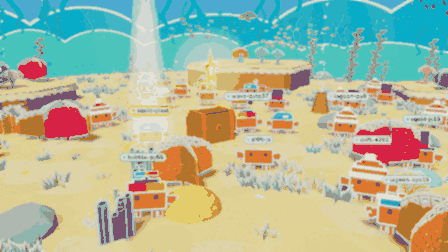

# 🦀 Stargazer Sea

<p align="center"><b>🇩🇪 Deutsch</b> · <a href="README.en.md">🇬🇧 English</a></p>

<p align="center">
  
</p>

<p align="center">
  <b>Ein animiertes Papier-Meer aller Stargazer: Jeder Stern wird zu einer Krabbe.</b><br>
  
</p>

<h3 align="center">👉 <a href="https://stargazer-sea.eppacher.net/">Zum Meer</a> 👈</h3>

## So wirst du zur Krabbe

1. **Stern geben:** oben rechts auf GitHub auf ⭐ *Star* klicken.
2. **Namen eingeben:** Auf der Seite auf „Jeder Stern wird zur Krabbe“ klicken und deinen GitHub-Namen eintippen. Bei der Schatzkiste liegt dann ein Ei mit deinem Namen.
3. **Schlüpfen sehen:** Nach 1–3 Minuten bricht das Ei auf, und deine Babykrabbe schlüpft heraus. Ihre Seltenheit siehst du sofort.
4. **Wachsen lassen:** In 3 Tagen wird sie groß. Nach 2 Tagen fällt die Eierschale ab, und ihr Hut wird enthüllt.

## Wachsen

| Alter | Stufe | Größe | Was man sieht |
|---|---|---|---|
| ab Stern | 🐣 Baby | 45 % | Seltenheit, Farbe, Muster, Eierschale auf dem Kopf |
| ab 1 Tag | Jungkrabbe | 62 % | wie Baby |
| ab 2 Tagen | Halbstark | 80 % | **Hut wird ausgepackt**, Sorte und Nummer sichtbar |
| ab 3 Tagen | Ausgewachsen | 100 % | alles |

Die Zeit läuft ab deinem ersten Stern und ist für alle Besucher gleich. Im Sammelalbum liegen wachsende Krabben eingepackt mit Schloss in der **Kinderstube**, damit niemand vorher spicken kann. Eine Zahl am 📖 zeigt, wie viele Krabben seit deinem letzten Blick ins Album neu, gewachsen oder ausgepackt sind.

## Seltenheiten

| Stufe | Chance | Hüte |
|---|---|---|
| Gewöhnlich | 50 % | Kein Hut, Bommelmütze, Baseball-Cap |
| Ungewöhnlich | 25 % | Matrosenmütze, Propellermütze, Seeblume |
| Selten | 15 % | Zylinder, Piratenhut, Wikingerhelm |
| Episch | 7 % | Zauberhut, Haifischflosse |
| Legendär | 2,5 % | Goldkrone, Heiligenschein (mit Flügeln) |
| Mythisch | 0,5 % | Sternenkrone |

**Jede Krabbe gibt es nur einmal.** Eine Sorte ist eine feste Kombination aus Hut, Hutfarbe, Schalenfarbe und Muster, insgesamt 4 140 verschiedene. Jede Nummer wird nur einmal vergeben. Sind alle Kombinationen einer Seltenheit vergeben, geht es mit einer **2. Auflage** weiter (erkennbar an farbigen Scherenspitzen), damit die Chancen immer gleich bleiben.

**Die ersten 100 Krabben** tragen für immer ein 🚩 Gründer-Fähnchen.

## Was es im Meer gibt

- Krabben laufen, tanzen, schlafen, grüßen sich, verlieben sich und machen Platz, wenn du eine anklickst
- 🥚 Stern-Ablauf: Ei bricht auf, Babykrabbe schlüpft, 🐣 Wachsen mit Hut-Enthüllung nach 2 Tagen, 💗 „Das bin ich“: die Seite begrüßt dich beim nächsten Besuch bei deiner Krabbe
- 📤 Sammelkarte jeder Krabbe zum Teilen, 📖 Sammelalbum mit allen Sorten
- 🌙 Tag und Nacht nach deiner Uhrzeit, 🎄 Winter- und 🎃 Halloween-Deko, 🎈 Krabbentag am Jahrestag des Sterns
- ⭐ Krabbe des Tages, Schatzkiste mit Konfetti, leise Unterwasser-Geräusche (standardmäßig aus)
- 🌊 Tauchgang beim Laden (Tippen überspringt); „Bewegung reduzieren“ des Betriebssystems wird beachtet
- 🌍 Deutsch und Englisch: oben links umschalten (sonst nach Sprache des Browsers)

## Fragen und Antworten

**Wie lange dauert es, bis meine Krabbe da ist?**
Meist 1–3 Minuten: So lange brauchen die GitHub Action und Cloudflare, um die Seite neu zu veröffentlichen.

**Kann ich neu würfeln?**
Nein. Seltenheit, Hut und Sorte werden beim ersten Stern einmal gewürfelt und gehören für immer zu deinem GitHub-Konto.

**Kann man den Hut schon vorher sehen?**
Nein. Gewürfelt wird zwar sofort beim Stern, aber in den ersten 2 Tagen steht der Hut nur **verschlüsselt** in `crabs.json` (auch in der Git-Geschichte und in den Logs der Action steht er nicht). Lesbar sind nur Seltenheit, Schalenfarbe und Muster. Nach 2 Tagen packt die Action ihn aus (sie läuft stündlich, also spätestens etwa eine Stunde danach).

**Was passiert, wenn ich den Stern wieder entferne?**
Deine Krabbe wird ausgeblendet (spätestens nach 6 Stunden). Gibst du wieder einen Stern, kommt **genau dieselbe** Krabbe zurück.

**Welche Daten werden gezeigt?**
Nur dein öffentlicher GitHub-Name, deine öffentliche Konto-Nummer und der Zeitpunkt deines Sterns. Nimmst du den Stern weg, wird dein Name aus der Datei gelöscht. Die Seite setzt keine Cookies und zählt keine Besucher. Einstellungen wie „Das bin ich“ oder der Ton bleiben nur in deinem eigenen Browser.

**Muss ich einen Stern geben, um mitzumachen?**
Nein, das Meer ist für alle offen. Es ist ein Bild aller, die dem Projekt einen Stern gegeben haben.

## Technik

```
⭐ Stern ─► GitHub Action ─► scripts/sync_stargazers.py ─► crabs.json (Commit) ─► Cloudflare
```

- Reine statische Seite, **kein Build-Schritt**: HTML, CSS, JavaScript-Module und [three.js](https://threejs.org) 0.160.0 (liegt in `vendor/three/`).
- Die Action läuft bei jedem Stern, jede Stunde und bei jedem Push. Junge Krabben werden versiegelt: Hut und Sorten-Nummer stehen in den ersten 48 Stunden nur verschlüsselt in `crabs.json` (HMAC-SHA256, Schlüssel als GitHub-Geheimnis). Sicherheitsnetz: Bei API-Fehlern, einem plötzlichen Einbruch der Sterne oder einer fehlgeschlagenen Selbstprüfung wird nichts gespeichert.
- Aussehen aus der Nummer: Python (`scripts/sync_stargazers.py`) und JavaScript (`js/variants.js`) rechnen gleich. `tests/variants_vectors.json` prüft das.

### Lokal ansehen

```bash
python3 -m http.server 8000
# → http://localhost:8000
```

Ohne Sterne läuft ein Demo-Modus mit Beispielkrabben. Bei weniger als 30 echten Krabben füllen graue „Beispiel“-Krabben das Meer auf.

Zum Ausprobieren an die Adresse hängen: `?vorspulen=50` (50 Stunden in die Zukunft, zum Wachsen), `?zeit=23` (Nacht), `?saison=winter|halloween|keine`, `?datum=2026-12-24`, `?lang=en` oder `?lang=de` (Sprache), `?reduced` (wie „Bewegung reduzieren“), `?hq` (keine automatische Qualitätsabsenkung).

### Tests

```bash
pip install -r requirements-dev.txt
python -m playwright install chromium
python -m unittest discover -s tests -v
```

Laufen auch automatisch bei jedem Push (`.github/workflows/tests.yml`).

### Einrichtung (eigenes Meer)

Das Repo liegt auf GitHub, die Seite läuft auf Cloudflare (Workers mit statischen Dateien; Cloudflare Pages geht genauso).

**GitHub**
1. Repo anlegen und diesen Ordner pushen (Hauptzweig `main`).
2. **Settings → Actions → General → Workflow permissions: „Read and write permissions“**
3. **Settings → Secrets and variables → Actions → New repository secret:** Name `KRABBEN_SCHLUESSEL`, Wert: eine lange Zufallszeichenfolge, zum Beispiel aus
   `python3 -c "import secrets; print(secrets.token_hex(32))"`. Den Schlüssel gut aufheben und nie ändern: Ohne ihn lassen sich versiegelte Krabben nicht mehr auspacken. Ohne Schlüssel funktioniert alles auch, dann sind die Hüte aber sofort in `crabs.json` lesbar.
4. In `config.js` Besitzer und Repo-Namen eintragen (dorthin führt der Stern-Knopf).

**Cloudflare**
5. **Workers & Pages → Create → Import a repository** und das Repo auswählen.
6. Build-Befehl leer lassen, Deploy-Befehl `npx wrangler deploy` (Standard). Die Einstellungen stehen in `wrangler.jsonc`, welche Dateien nicht auf die Seite kommen, steht in `.assetsignore`.
7. Unter **Settings → Domains & Routes** (bei Pages: **Custom domains**) die eigene Adresse verbinden (hier `stargazer-sea.eppacher.net`). Wer das Projekt für ein eigenes Meer kopiert, trägt seine Adresse oben in dieser README und bei `og:url`, `og:image` und `twitter:image` in `index.html` ein, damit geteilte Links ein Vorschaubild zeigen.

**Los geht's**
8. **Actions → Stargazer Sea → Run workflow** einmal von Hand starten.

Cloudflare baut nach jedem Commit neu, also bei jedem neuen Stern und wenn ein Hut ausgepackt wird. Ein Durchlauf dauert unter einer Minute, der kostenlose Tarif reicht dafür gut.

Hinweis: GitHub schaltet zeitgesteuerte Abläufe in öffentlichen Repos nach 60 Tagen ohne Aktivität ab. Dann im Reiter „Actions“ wieder einschalten. Jeder neue Stern startet die Action trotzdem.

### Dateien

| Datei | Inhalt |
|---|---|
| `index.html`, `style.css` | Seite und Oberfläche |
| `js/main.js` | Szene, Kamera, Daten, Bedienung, Stern-Ablauf |
| `js/ocean.js`, `js/paper.js` | Das Meer und alle Papier-Zeichnungen |
| `js/crab.js`, `js/hats.js` | Krabbe (Figur, Gesichter, Verhalten) und Hüte |
| `js/variants.js` | Sorten und Auflagen: aus der Nummer wird das Aussehen |
| `js/growth.js` | Wachsen: Stufen, Kinderstube, Neuheiten |
| `js/card.js`, `js/album.js` | Sammelkarte und Sammelalbum |
| `js/intro.js` | Tauchgang beim Laden |
| `js/i18n.js`, `js/lang.js` | Alle Texte auf Deutsch und Englisch, Sprach-Umschalter |
| `js/sound.js` | Unterwasser-Geräusche (echte Aufnahmen, CC0) |
| `crabs.json` | Alle Krabben (pflegt die Action) |
| `data/rarities.json` | Seltenheiten, Hüte, Chancen |
| `tests/` | Automatische Tests |

## Lizenz

[MIT](LICENSE) © 2026 Alexander Eppacher

## Quellen

- three.js: MIT-Lizenz (`vendor/three/LICENSE`)
- Geräusche: CC0, siehe [`assets/sounds/QUELLEN.md`](assets/sounds/QUELLEN.md)
